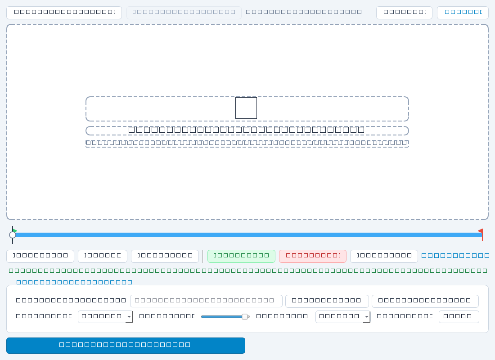
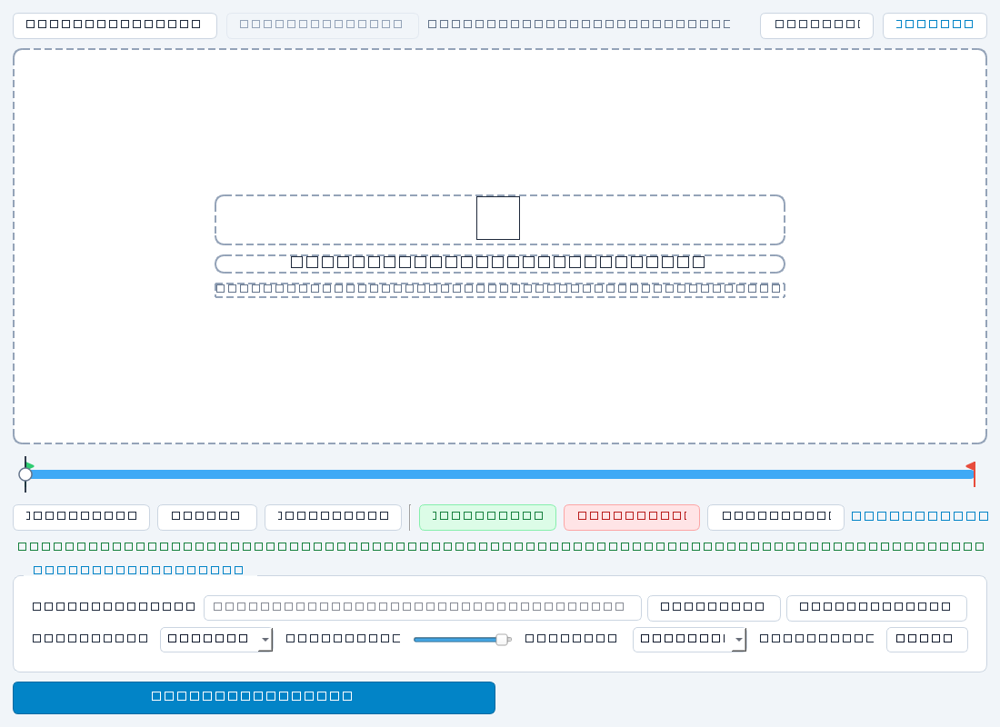

# MP4 to Images Studio 🎬 ➡️ 🖼️

<div align="center">

[](LICENSE)
[](https://github.com/john-lebrument/MP4-to-JPG/releases)
[](https://www.python.org/)
[](https://pypi.org/project/PyQt6/)
[](https://pypi.org/project/opencv-python/)
[](#-version-française)

**Application Windows moderne de découpe et d'extraction d'images haute performance depuis n'importe quelle vidéo.**  
*Modern Windows video frame extractor and trimmer with high performance.*

---

### 🌐 Choix de langue / Language Selection
**[🇫🇷 Version Française](#-version-française)** &nbsp;•&nbsp; **[🇬🇧 English Version](#-english-version)**

---

### 📸 Aperçu / Preview (Bilingue FR & EN)

| 🇫🇷 Interface en Français | 🇬🇧 English Interface |
| :---: | :---: |
|  |  |

*Basculez instantanément entre le français et l'anglais d'un simple clic sur le bouton dédié !*  
*Switch seamlessly between French and English with a single click!*

---

</div>

<br>

---

## 🇫🇷 Version Française

### ✨ Fonctionnalités principales

- **🌐 Interface Bilingue (Français / Anglais)** :
  - Commutateur instantané en 1 clic (`🇬🇧 English` / `🇫🇷 Français`) dans la barre supérieure.
  - Traduction intégrale et dynamique : contrôles, messages, options, infobulles et fenêtres de confirmation.
  - La langue sélectionnée est automatiquement conservée lors des prochaines ouvertures.
- **🎨 Thèmes Clair et Sombre** :
  - Thème clair moderne activé par défaut.
  - Mode sombre accessible en 1 clic pour le confort visuel.
- **📥 Import facile & Glisser-Déposer (Drag & Drop)** :
  - Bouton `📂 Ouvrir une vidéo...` compatible avec tous les formats courants (`.mp4`, `.mov`, `.avi`, `.mkv`, `.webm`, `.m4v`, etc.).
  - Grande zone d'accueil interactive en glisser-déposer.
  - **Glisser-déposer par-dessus une vidéo existante** : glissez un nouveau fichier directement sur la vidéo en cours pour la remplacer immédiatement.
- **✂️ Découpe précise & Marqueurs [In] / [Out]** :
  - Timeline interactive avec visualisation en temps réel de la séquence sélectionnée.
  - Marqueur d'entrée **[In]** (vert) et marqueur de sortie **[Out]** (rouge).
  - Déplacement pas-à-pas à la trame exacte (`⏮ -1 trame` / `⏭ +1 trame`, ou flèches directionnelles).
  - Lecture / Pause fluide (`Espace` ou clic direct sur la vidéo).
  - Compteur d'images estimées et affichage des métadonnées (résolution, FPS, durée).
- **⚙️ Options d'extraction sur mesure** :
  - **Formats d'image** : `JPG` (qualité ajustable de 10% à 100%), `PNG` (sans perte), `WEBP`, `BMP`.
  - **Cadence configurable** : 100% des images, 1 image sur 2, 1 sur 5, 1 sur 10, ou 1 image par seconde.
  - **Sous-dossier automatique** : mémorisation de votre dossier racine de sortie et génération automatique d'un sous-dossier dédié au nom de la vidéo (`<nom_video>_images`) avec auto-incrémentation pour éviter d'écraser vos précédentes extractions.
  - **Préfixe personnalisé** : configurez le nom des fichiers extraits (ex : `frame_00001.jpg`).
- **⚡ Performance & Sécurité des fichiers** :
  - Moteur d'extraction multithreadé avec OpenCV sans gel de l'interface.
  - Suivi en temps réel avec barre de progression et vitesse de traitement (images/s).
  - Bouton **« ❌ Décharger la vidéo »** pour libérer immédiatement le verrou Windows sur le fichier et permettre son déplacement ou sa suppression dans l'Explorateur.
  - Fermeture 100% propre (aucun processus fantôme en arrière-plan).

---

### 🚀 Téléchargement & Démarrage

#### Option 1 : Exécutable autonome .exe (Recommandé - Aucun Python requis) 🎉
Téléchargez l'application prête à l'emploi directement depuis les **[Releases GitHub](https://github.com/john-lebrument/MP4-to-JPG/releases)** :
1. Téléchargez le fichier **`MP4_to_Images_Studio.exe`**.
2. Double-cliquez pour lancer l'application immédiatement sur n'importe quel PC Windows 10/11.

#### Option 2 : Lancement avec Python
```bash
# Cloner le dépôt
git clone https://github.com/john-lebrument/MP4-to-JPG.git
cd MP4-to-JPG

# Créer l'environnement virtuel et installer les dépendances
python -m venv venv
venv\Scripts\activate
pip install -r requirements.txt

# Lancer l'application
python app.py
```
*(Ou double-cliquez directement sur `run.bat` ou `Lancer_Application.vbs`)*.

---

### ⌨️ Raccourcis clavier

| Raccourci | Action |
|:---|:---|
| <kbd>Espace</kbd> | Lecture / Pause |
| <kbd>←</kbd> | Reculer d'une trame (-1 frame) |
| <kbd>→</kbd> | Avancer d'une trame (+1 frame) |
| <kbd>I</kbd> | Poser le marqueur de début (**In**) |
| <kbd>O</kbd> | Poser le marqueur de fin (**Out**) |

<br>

---

## 🇬🇧 English Version

### ✨ Key Features

- **🌐 Bilingual UI (English / French)**:
  - Instant one-click language toggle (`🇬🇧 English` / `🇫🇷 Français`) in the top navigation bar.
  - Full dynamic translation of all labels, buttons, dialogs, status messages, cadence options, and tooltips.
  - Remembers your preferred language automatically across sessions.
- **🎨 Light & Dark Themes**:
  - Crisp, modern Light Mode set by default.
  - Dark Mode available with a single click for comfortable viewing.
- **📥 Easy Import & Drag-and-Drop**:
  - `📂 Open video...` button supporting all standard formats (`.mp4`, `.mov`, `.avi`, `.mkv`, `.webm`, `.m4v`, etc.).
  - Intuitive drag-and-drop placeholder zone.
  - **Direct Drag-and-Drop Replacement**: drag a new video directly over a playing/loaded video to replace it on the fly.
- **✂️ Frame-Accurate Trimming & [In] / [Out] Markers**:
  - Interactive custom timeline with highlighted sequence selection.
  - Green **[In]** start marker and red **[Out]** end marker.
  - Frame-by-frame precision stepping (`⏮ -1 frame` / `⏭ +1 frame` or keyboard arrow keys).
  - Smooth playback controls (`Space` or click directly on video).
  - Real-time sequence metadata (resolution, frame rate, duration, estimated frames count).
- **⚙️ Flexible Extraction Options**:
  - **Image formats**: `JPG` (with 10-100% quality slider), `PNG` (lossless), `WEBP`, and `BMP`.
  - **Frame extraction rate**: All frames (100%), 1 frame every 2, every 5, every 10, or 1 frame per second.
  - **Smart output folders**: Remembers your preferred base directory and automatically creates a dedicated subfolder named `<video_name>_images` with auto-increment counter to avoid overwriting files.
  - **Customizable prefix**: Set your preferred file prefix (e.g. `frame_00001.jpg`).
- **⚡ High Performance & Clean Process Exit**:
  - Multi-threaded OpenCV extraction engine that keeps the interface responsive.
  - Live progress bar showing extracted frames and extraction speed (fps).
  - **"❌ Unload video"** button to release Windows file locks immediately so you can rename or delete files in File Explorer.
  - Zero lingering background processes upon exit.

---

### 🚀 Download & Getting Started

#### Option 1: Standalone Windows .exe (Recommended - No Python needed) 🎉
Download the ready-to-use executable from **[GitHub Releases](https://github.com/john-lebrument/MP4-to-JPG/releases)**:
1. Download **`MP4_to_Images_Studio.exe`**.
2. Double-click to run anywhere on Windows 10/11.

#### Option 2: Run with Python
```bash
# Clone the repository
git clone https://github.com/john-lebrument/MP4-to-JPG.git
cd MP4-to-JPG

# Create virtual environment and install dependencies
python -m venv venv
venv\Scripts\activate
pip install -r requirements.txt

# Run application
python app.py
```
*(Or double-click `run.bat` or `Lancer_Application.vbs`)*.

---

### ⌨️ Keyboard Shortcuts

| Shortcut | Action |
|:---|:---|
| <kbd>Space</kbd> | Play / Pause |
| <kbd>←</kbd> | Step backward 1 frame |
| <kbd>→</kbd> | Step forward 1 frame |
| <kbd>I</kbd> | Set Start marker (**In**) |
| <kbd>O</kbd> | Set End marker (**Out**) |

---

## 🧱 Project Structure

```text
MP4toJPG/
├── app.py                   # PyQt6 Main application window & bilingual UI
├── timeline_slider.py       # Custom interactive timeline with In/Out markers
├── extractor.py             # Multithreaded OpenCV frame extraction worker
├── requirements.txt         # Python dependencies (PyQt6, opencv-python)
├── run.bat                  # Automated 1-click launcher with venv auto-setup
├── compilation_exe.bat      # 1-click PyInstaller standalone build script
├── Lancer_Application.vbs   # Silent launcher (no black CMD window)
├── Creer_Raccourci_Bureau.vbs # Creates a desktop shortcut with custom icon
├── icon.png / icon.ico      # Application icons
└── docs/                    # Screenshots & documentation assets
    ├── screenshot_fr.png    # French interface capture
    └── screenshot_en.png    # English interface capture
```

---

## 📄 Licence / License

Projet sous licence PolyForm Noncommercial 1.0.0 : réutilisation, modification et redistribution pour des usages non commerciaux uniquement. Voir [LICENSE](LICENSE).  
*Distributed under the PolyForm Noncommercial License 1.0.0 for noncommercial use only. See [LICENSE](LICENSE).*
